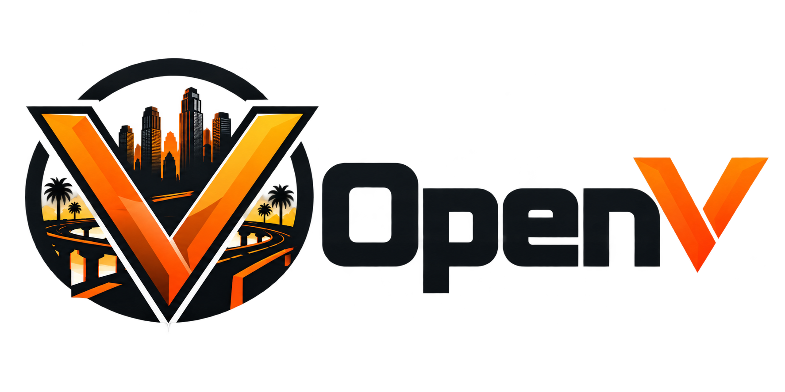

  

# OpenV

**An experimental, community-focused GTA V multiplayer project.**

OpenV is being developed as an alternative multiplayer and roleplay platform for Grand Theft Auto V. The aim is to give communities a way to host their own servers, manage player identities, and build custom experiences. The project currently uses a fork of the Cfx/FiveM codebase as a technical starting point.

> **Development status: experimental.** OpenV is not yet a finished or verified replacement for FiveM. A successful build does not mean there is a ready-to-install client or working multiplayer session. Do not use this repository as a production game server or promise working player access yet.

## What is being built?

- **Windows game client:** an experimental client build, not yet validated as a complete installer.
- **Multiplayer server:** work toward an independently deployable, compatible hosting platform.
- **Community accounts:** a separate identity service intended to support community sign-in and authorized server authentication.
- **Roleplay resources:** ongoing work to assess compatibility with legitimate existing community scripts and game resources.

OpenV is intended for community administrators and developers. Players should not download experimental build artifacts expecting a playable release.

## Where to start

| You want to… | Go here |
| --- | --- |
| Understand the Windows client experiment | [Windows gaming-PC test guide](docs/openv/GAMING_PC_TEST.md) |
| Inspect outstanding technical dependencies | [Dependency review](docs/openv/DEPENDENCY_TRACE.md) |
| View the experimental build workflow | [Windows client workflow](.github/workflows/openv-windows-client.yml) |
| Explore community identity development | [openv-identity](https://github.com/bradjtrammell/openv-identity) |
| Explore server development | [openv-server](https://github.com/bradjtrammell/openv-server) |
| Explore the administration project | [openv-admin](https://github.com/bradjtrammell/openv-admin) |
| Explore community resource data | [openv-data](https://github.com/bradjtrammell/openv-data) |
| Read the inherited build notes | [Developer documentation](docs/README.md) |

The companion repositories are separate development components, not proof of an end-to-end released platform.

## Can I play OpenV now?

**Not as a verified public release.** The current Windows build is experimental. Before a user-ready version can be announced, the team must validate a complete client package, game launch, authorized authentication, server connection, script and resource loading, and gameplay stability.

For testers with a legally obtained GTA V installation, follow the [gaming-PC test guide](docs/openv/GAMING_PC_TEST.md). Its preflight does not establish that a playable OpenV client exists.

## Safety and compatibility

OpenV development must respect software licenses, legitimate game ownership, and third-party component rights. No build should be represented as production-ready until actual client/server tests support that claim. Do not bypass entitlement checks or redistribute proprietary runtime components without authorization.

To report a problem, use the repository's [Issues](https://github.com/bradjtrammell/openv/issues) area and include your platform, steps to reproduce, relevant logs, and the exact commit or build tested. Never paste passwords, access tokens, or private account details into issues.

## Origins, licenses, and attribution

This project is derived from the [Cfx/FiveM source code](https://github.com/citizenfx/fivem). Upstream development, trademarks, and third-party rights remain with their respective owners. OpenV is an independent experimental effort; it is **not** an official FiveM, Cfx.re, or Rockstar Games product.

Review the [repository license](LICENSE), [included licenses](LICENSES), [third-party notices](THIRD_PARTY_NOTICES.md), and [security policy](SECURITY.md) before using, changing, packaging, or distributing any part of the code. The upstream project and its own instructions remain available at [citizenfx/fivem](https://github.com/citizenfx/fivem).

**Project status:** experimental development; no generally available, verified player release.
